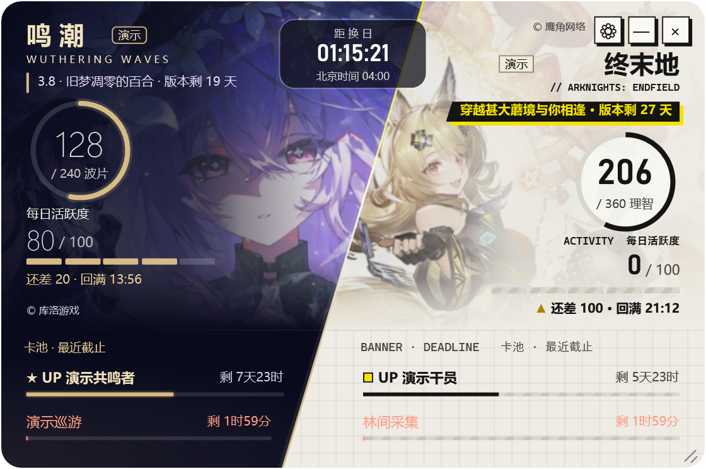

# Wuwa & Endfield Daily Reminder · 鸣潮和终末地日常及活动提醒插件

[简体中文](README.md) · **English**

**[Download the latest GameDailyWidget.exe (Windows x64)](https://github.com/KIRIKOMEOW/wuwa-endfield-daily-reminder/releases/latest/download/GameDailyWidget.exe)**

Double-click the downloaded EXE to start the widget. The .NET runtime is included.

A Windows desktop widget for Wuthering Waves and Arknights: Endfield. The split overview shows Waveplates, Sanity, daily activity and the next event deadline for each game.



*The v1.6.3 split overview with demo data. The widget UI is in Chinese.*

## Using the widget

- **Check your dailies.** Select either half to open that game's details. Resource balances come from the latest server reading. The center clock counts down to the 04:00 Beijing-time reset and shows the equivalent time on your computer.
- **Track deadlines.** Select an event or banner at the bottom to see its schedule and official announcement. Events support deadline reminders, claim tracking and an ignore option. Banners show featured items and dates.
- **Keep it out of the way.** Resize the card, dock it at the screen edge or hide it in the system tray. Startup and pre-reset reminders are configurable.

Wuthering Waves uses an existing sign-in from the mainland Chinese official launcher. For Endfield, scan the QR code with Skland and select a character. Demo mode works without an account. Event and banner schedules come from the games’ official announcements. Wuthering Waves banner times come from the in-game notice board.

## Build and run

Install the .NET 10 SDK on Windows x64, then open PowerShell in the repository root. Build the widget and launch it with sample data:

```powershell
dotnet build .\GameDailyWidget\GameDailyWidget.csproj -c Release
dotnet run --project .\GameDailyWidget\GameDailyWidget.csproj -c Release --no-build -- --demo
```

Omit the final `-- --demo` to use your own account. Run `.\GameDailyWidget\build-release.ps1` to build a self-contained portable package. The archives are written to `GameDailyWidget\dist\`.

[Detailed user guide and offline checks (Chinese)](GameDailyWidget/README.md)

## License

This project's original code is licensed under the [MIT License](LICENSE). Game artwork (including the artwork in the preview screenshot) and trademarks for Wuthering Waves and Arknights: Endfield belong to their respective owners and are outside the scope of this license. For third-party component licenses, see the [third-party notices](GameDailyWidget/THIRD_PARTY_NOTICES.txt).
