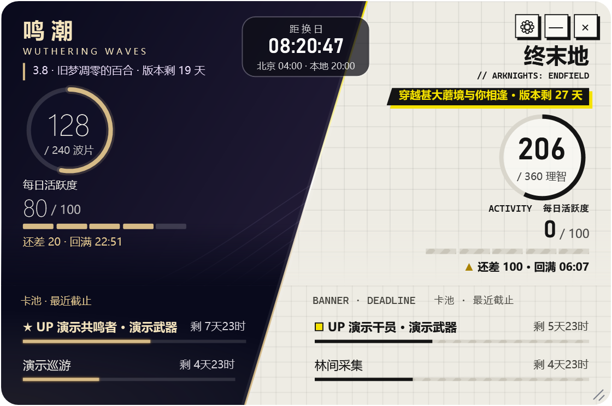

# Wuwa & Endfield Daily Reminder · 鸣潮和终末地日常及活动提醒插件

**简体中文** · [English](README.en.md)

**[下载 Windows x64 便携版（v1.6.2，ZIP）](https://github.com/KIRIKOMEOW/wuwa-endfield-daily-reminder/releases/download/v1.6.2/Wuwa-Endfield-Daily-Reminder-v1.6.2-win-x64.zip)**

完整解压 ZIP，双击文件夹中的 `GameDailyWidget.exe` 即可启动。便携包已包含 .NET 运行时。

一个常驻 Windows 桌面的双游戏组件。在「双生」总览里，一眼看清鸣潮的波片、终末地的理智、两边今天还差多少活跃度，以及哪项活动最先截止。



*v1.6.2「双生」总览。*

## 日常使用

- **查日常**　点击总览的任意一侧进入对应游戏。波片和理智显示服务器最近一次返回的读数。中央按北京时间 04:00 倒计时，同时显示本地换日时刻。
- **看截止**　点击总览底部的活动或卡池，查看公告时间与原文。活动支持截止提醒、标记已领完和忽略。卡池只展示排期和 UP 信息。
- **收回桌面空间**　可调整缩放、贴边自动收起或隐藏到托盘。设置中可以调整启动提醒和换日前提醒。

鸣潮使用国服官方启动器已有的授权；终末地在组件内用森空岛扫码后选择角色。可以先用演示数据试用。活动和卡池时间来自两款游戏的官方公告。

## 从源码运行

在 Windows x64 上安装 .NET 10 SDK，在仓库根目录打开 PowerShell。下面两条命令分别构建组件、使用演示数据启动：

```powershell
dotnet build .\GameDailyWidget\GameDailyWidget.csproj -c Release
dotnet run --project .\GameDailyWidget\GameDailyWidget.csproj -c Release --no-build -- --demo
```

接入自己的账号时，去掉最后的 `-- --demo`。生成包含运行时的便携版可运行 `.\GameDailyWidget\build-release.ps1`，压缩包位于 `GameDailyWidget\dist\`。

[中文使用说明与离线检查](GameDailyWidget/README.md)

## 许可证

本项目的原创代码采用 [MIT 许可证](LICENSE)。鸣潮和明日方舟：终末地的游戏图片（包括预览截图中的立绘）和商标归各自权利人所有，不在本项目的 MIT 授权范围内。第三方组件的许可见[第三方声明](GameDailyWidget/THIRD_PARTY_NOTICES.txt)。
